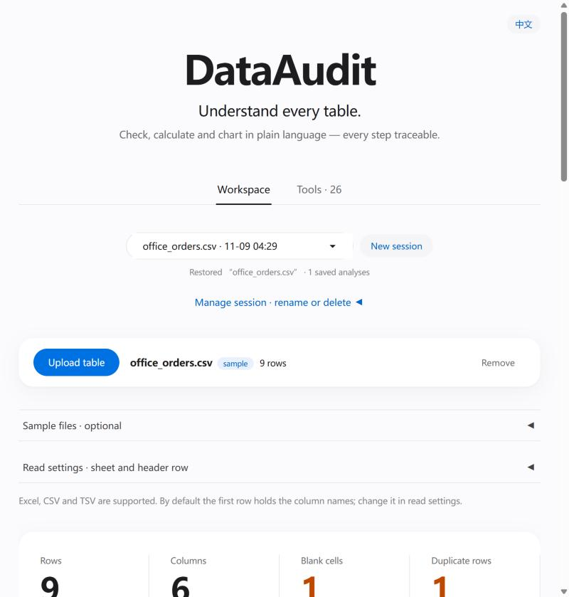

# DataAudit

[中文](README.md) · English

An agent for analyzing spreadsheets in plain language. Upload an Excel or CSV file and ask something like
"total sales by region" or "which columns have missing values". It decides which analysis functions to call,
computes the result with pandas, and shows the answer together with every step it took.

I built this while working through the [Hello-Agents](https://datawhalechina.github.io/hello-agents/) tutorial,
to find out what it actually takes to get a tool-calling agent from a notebook demo to something deployed.



## Features

- 26 read-only analysis functions: missing values, duplicates, outliers, grouped totals, multi-condition filters,
  per-row arithmetic, date summaries, charts, and comparison against a second table.
- The model only picks functions and arguments; every number is computed by pandas. Numbers that appear in the
  answer are checked against the computed results, and mismatches are flagged.
- Each analysis can be downloaded as a report, a result table, a chart, and a standalone Python script that
  recomputes the result without the agent.
- Sessions are stored in a local SQLite database, so they survive page refreshes and restarts; follow-up
  questions reuse the fields from the previous turn.
- Chinese page at `/`, English page at `/en`.

## Running it

Python 3.11 or 3.12.

```bash
git clone https://github.com/MeiJunG/dataaudit-agent.git
cd dataaudit-agent
python -m venv .venv
# Windows: .venv\Scripts\activate    macOS / Linux: source .venv/bin/activate
pip install -r requirements.txt
cp .env.example .env               # Windows: copy .env.example .env
```

Put your model service in `.env`. Any OpenAI-compatible endpoint with function calling works: a local
llama.cpp / vLLM / Ollama server, or a hosted API such as DeepSeek. The file has examples for each.

```ini
OPENAI_BASE_URL=https://api.deepseek.com/v1
OPENAI_API_KEY=sk-...
MODEL_NAME=deepseek-chat
```

```bash
DATAAUDIT_LANG=en python -m src.model_check   # can it reach the model? does tool calling work?
python app.py                                 # then open http://127.0.0.1:7860/en
```

(PowerShell: `$env:DATAAUDIT_LANG='en'; python -m src.model_check`.)

Without a model the page still opens; you just can't ask questions. Table preview and the column overview still work.

There is also a Python API, see [docs/API.md](docs/API.md) and `examples/api_client.py`.

## How it works

The agent is a LangGraph loop: the model sees the question and the table schema, picks a tool, runs it, reads the
result, and decides what to do next. It stops after 6 steps, and repeating the same call is blocked. There is no
fixed tool order.

The main problem during development was that a small model (I deployed a 4-bit Qwen2.5-7B on a single V100) often
picked the wrong tool or made up numbers in its answer. Three things helped:

1. The model first classifies the question (chart, table calculation, or data-quality check) and only sees the
   tools for that category.
2. Answers that can be rendered directly from the results, such as tables and charts, are not rewritten by the model.
3. Numbers in the remaining answers are checked one by one against the tool outputs.

Main code:

| Path | What it does |
|---|---|
| `src/agent.py` | agent loop, question routing, step limit |
| `src/tools.py`, `src/table_tools.py`, ... | analysis functions |
| `src/grounding.py` | checking numbers in answers |
| `src/session_store.py` | saved sessions |
| `src/repro_script.py` | reproduction scripts |
| `app.py`, `src/interface.py` | Gradio UI |

## Tests

```bash
python -m pytest -q
```

The unit tests use a mocked model, need no GPU, and run on Linux and Windows.

There are also end-to-end checks against the real model in `evaluation/`: generic table tasks 8/8, multi-domain
tasks 11/11, two-table comparison 5/5. I wrote these tasks myself during development to catch regressions; they
are not an accuracy benchmark. Earlier failures are kept in [docs/VALIDATION.md](docs/VALIDATION.md).

## Limitations

- One worksheet at a time, with limits on upload size and rows/columns (set in `.env`).
- Outlier detection only points out values worth a second look; it doesn't prove they are wrong.
- No user accounts. It listens on localhost by default; put it behind your own login before sharing it.
- If the page is closed or the service restarts mid-analysis, the run is not resumed. Finished analyses are kept.
- Results depend a lot on the model. Smaller models pick the wrong fields more often.
- The model's own sentences follow the language of your question, even on the English page.

## Docs

[API](docs/API.md) · [Deployment](docs/DEPLOYMENT.md) · [Saved sessions](docs/PERSISTENT_SESSIONS.md) · [Test records](docs/VALIDATION.md)

## License

[MIT](LICENSE)
