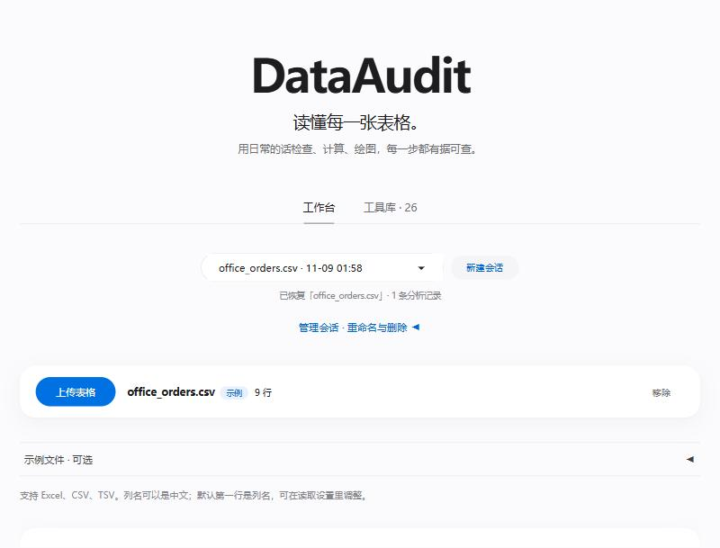

# DataAudit

中文 · [English](README.en.md)

一个用自然语言分析表格的 Agent。上传 Excel 或 CSV 后可以直接提问，比如“按地区统计销售额”“哪些列有空值”。
它会自己决定调用哪些分析函数，用 pandas 算出结果，再把结论和每一步的调用过程一起展示出来。

这是我跟着 [Hello-Agents](https://datawhalechina.github.io/hello-agents/) 教程学习时做的项目，
想弄清楚一个 Agent 从调用工具到部署上线，中间实际会遇到哪些问题。



## 功能

- 26 个只读的分析函数：缺失值、重复行、异常值、分组汇总、多条件筛选、逐行计算、日期汇总、画图、两张表对照等。
- 模型只负责选择函数和参数，数字全部由 pandas 计算。回答里出现的数字会和计算结果核对，对不上的会标出来。
- 每次分析都可以下载报告、结果表、图表，以及一份不依赖 Agent、可以单独运行重算结果的 Python 脚本。
- 会话保存在本地 SQLite 里，刷新页面或重启服务后还能接着看；追问时会沿用上一轮选过的字段。
- 中文页面在 `/`，英文页面在 `/en`。

## 运行

需要 Python 3.11 或 3.12。

```bash
git clone https://github.com/MeiJunG/dataaudit-agent.git
cd dataaudit-agent
python -m venv .venv
# Windows: .venv\Scripts\activate    macOS / Linux: source .venv/bin/activate
pip install -r requirements.txt
cp .env.example .env               # Windows: copy .env.example .env
```

在 `.env` 里填上模型服务。任何兼容 OpenAI 接口、支持函数调用的模型都可以，本地的 llama.cpp / vLLM / Ollama
或者 DeepSeek 这类在线 API 都行，文件里有几种写法的例子：

```ini
OPENAI_BASE_URL=https://api.deepseek.com/v1
OPENAI_API_KEY=sk-...
MODEL_NAME=deepseek-chat
```

```bash
python -m src.model_check   # 检查能否连上模型、是否支持函数调用
python app.py               # 打开 http://127.0.0.1:7860
```

没配置模型也能打开页面，只是不能提问，表格预览和每列的概览照常可用。

也可以用代码调用，见 [docs/API.md](docs/API.md) 和 `examples/api_client.py`。

## 实现思路

Agent 部分用 LangGraph 写成一个循环：模型看到问题和表格结构后选一个工具，执行，看结果，再决定下一步。
最多 6 步，连续重复同样的调用会被拦下来。工具的调用顺序没有写死。

开发中最主要的问题是小模型（我部署的是 Qwen2.5-7B 的 4-bit 量化版，跑在一张 V100 上）经常选错工具，
或者在回答里自己编数字。针对这一点做了三件事：

1. 先让模型判断问题属于哪一类（画图、表格计算、数据质量检查），只给它这一类的工具；
2. 表格、图表这类可以直接由计算结果生成的回答，不再交给模型改写；
3. 其余回答里的数字，逐个和工具返回的结果核对。

主要代码：

| 路径 | 内容 |
|---|---|
| `src/agent.py` | Agent 循环、问题分类、步数限制 |
| `src/tools.py`、`src/table_tools.py` 等 | 分析函数 |
| `src/grounding.py` | 回答中的数字核对 |
| `src/session_store.py` | 会话保存 |
| `src/repro_script.py` | 生成复现脚本 |
| `app.py`、`src/interface.py` | Gradio 页面 |

## 测试

```bash
python -m pytest -q
```

单元测试用的是模拟模型，不需要 GPU，在 Linux 和 Windows 上都跑过。

另外写了几组接真实模型的端到端检查（`evaluation/`）：通用表格任务 8/8、多领域任务 11/11、两表对照 5/5。
这些题目是我在开发过程中自己写的，用来防止改代码时把已有功能改坏，不能当作准确率基准。
之前失败的记录都保留在 [docs/VALIDATION.md](docs/VALIDATION.md) 里。

## 限制

- 一次只分析一个工作表，上传大小和行列数有上限（在 `.env` 里设置）。
- 异常值检测只是给出值得复核的数据，不代表一定有错。
- 没有用户登录，默认只在本机访问。如果要给别人用，需要自己加登录或放在内网里。
- 分析中途关掉页面或重启服务，不会从中间继续，需要重新提问；已经完成的分析会保留。
- 效果很依赖接入的模型，模型越小越容易选错字段。

## 文档

[API](docs/API.md) · [部署](docs/DEPLOYMENT.md) · [会话保存](docs/PERSISTENT_SESSIONS.md) · [测试记录](docs/VALIDATION.md)

## License

[MIT](LICENSE)
